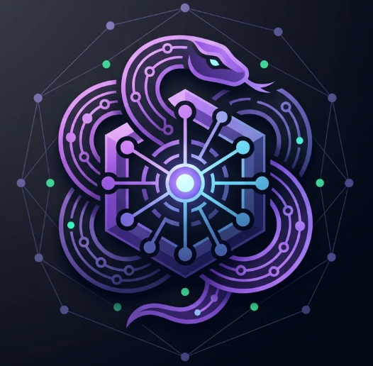
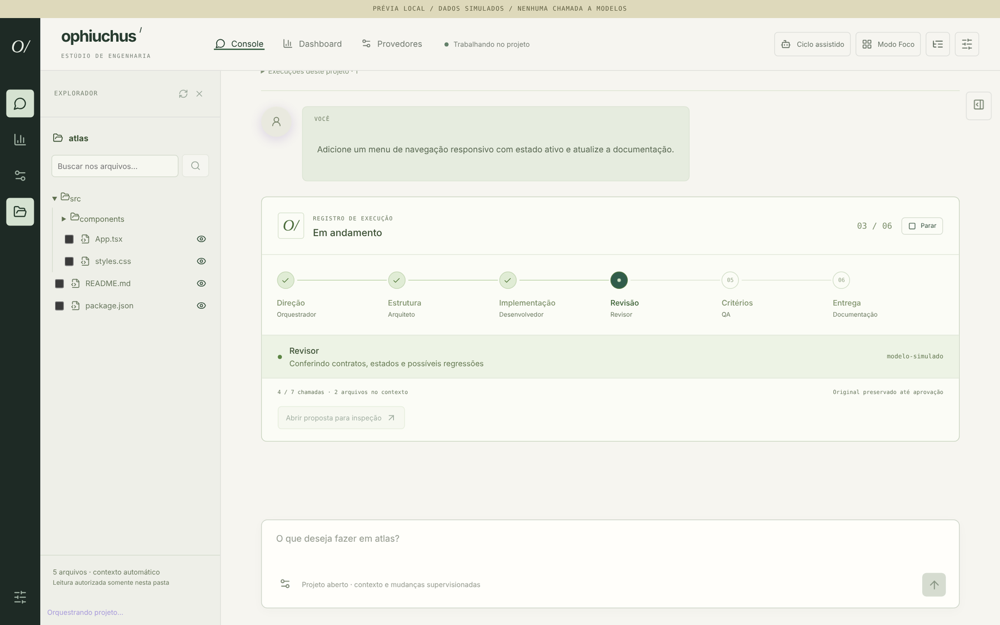
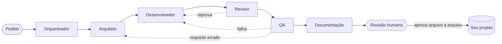
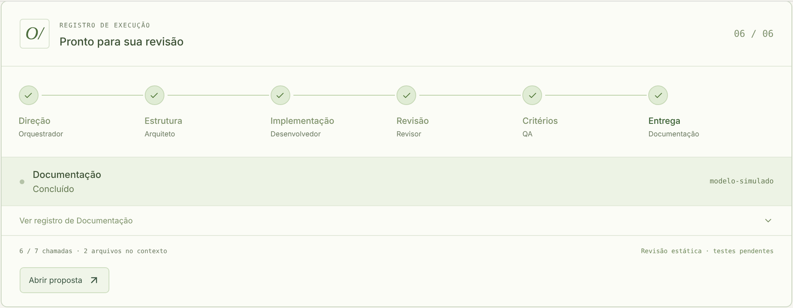
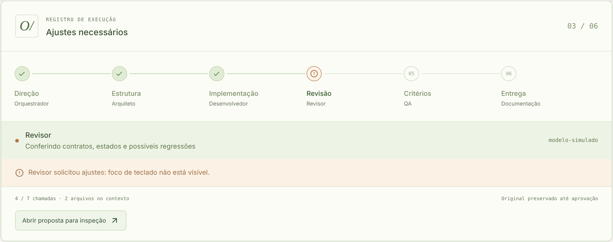
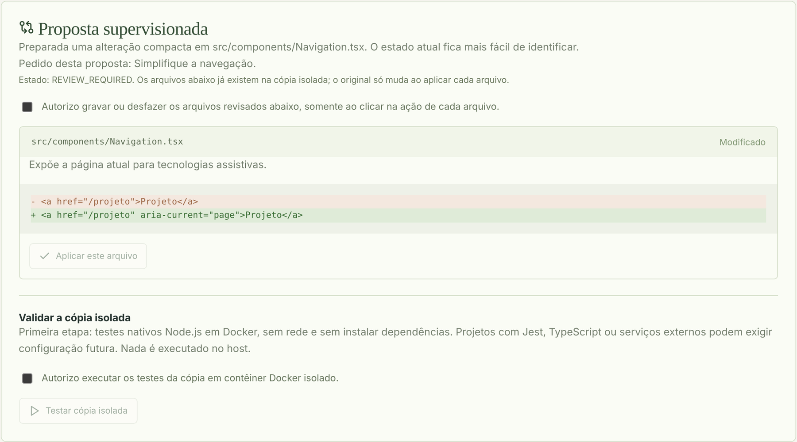
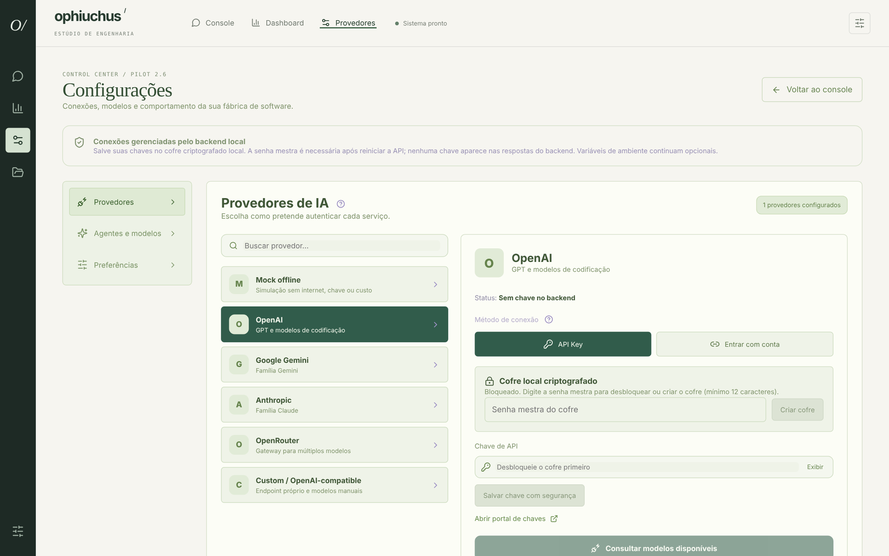
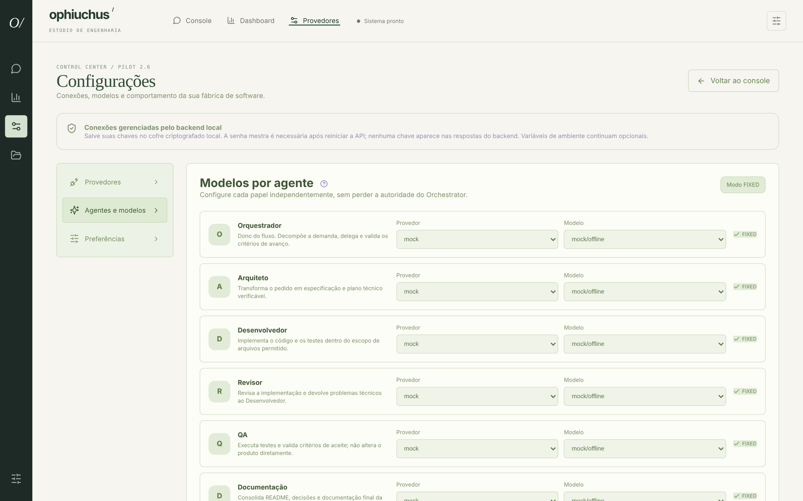
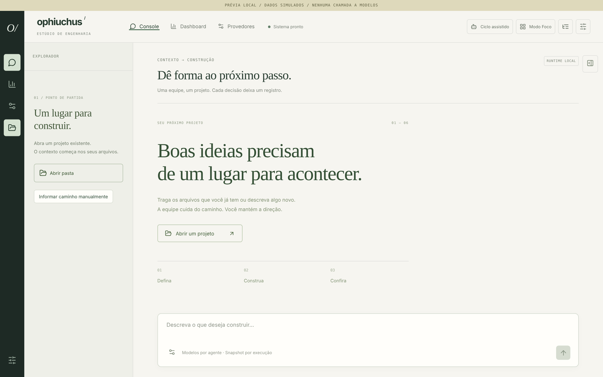

<div align="center">



# Ophiuchus

**Uma fábrica de software com agentes de IA, onde você mantém a direção.**

*An agentic software factory engineering console for visual orchestration, deterministic state tracking, and human-in-the-loop validation.*


<br />



<sub>Console real do Ophiuchus (prévia offline com dados simulados): a equipe de seis agentes trabalhando em sequência, etapa 3 de 6.</sub>

</div>

---

## O que é

O Ophiuchus é um **console de engenharia agêntica**: você descreve o que quer construir (ou abre uma pasta de projeto existente) e uma **equipe de seis agentes**, cada um com um papel e um modelo próprio, planeja, projeta, implementa, revisa, confere critérios e documenta a mudança.

A ideia central é **confiança verificável**, não automação cega:

- 🧭 **Orquestração visual**: cada etapa e cada repasse entre agentes ficam visíveis e inspecionáveis.
- 🧱 **Estado determinístico**: uma máquina de estados independente do React controla o fluxo, com snapshot imutável das configurações a cada execução.
- 🙋 **Humano no circuito**: nada é gravado no seu projeto sem aprovação explícita, arquivo por arquivo.
- 🔍 **Honestidade sobre validação**: o sistema separa *parecer de IA* de *evidência real de testes*. Um status `READY` significa revisão estática concluída, **não** teste executado.

## A equipe

| # | Etapa | Agente | O que faz |
|---|-------|--------|-----------|
| 1 | Direção | **Orquestrador** | Decompõe o pedido, define o plano e os critérios de aceite |
| 2 | Estrutura | **Arquiteto** | Transforma o pedido em especificação e contratos técnicos |
| 3 | Implementação | **Desenvolvedor** | Prepara uma proposta isolada de código (e testes) |
| 4 | Revisão | **Revisor** | Revisão independente; pode devolver problemas ao responsável |
| 5 | Critérios | **QA** | Valida critérios de aceite (estático e, com autorização, via Docker) |
| 6 | Entrega | **Documentação** | Consolida README, decisões e documentação da feature |

Cada agente pode usar **um provedor e um modelo diferente**. Os vínculos são congelados no início da execução, então mudar a configuração no meio do caminho não afeta um fluxo em andamento.



> Falhas voltam para o agente responsável (código → Desenvolvedor, requisitos → especificação, arquitetura → Arquiteto), com limite de correções por etapa e por execução. Ao exceder o limite, o fluxo **bloqueia e pede intervenção humana** em vez de repetir indefinidamente.

## Veja funcionando

### Fluxo completo, pronto para revisão



As seis etapas concluídas. Repare no rodapé: **"Revisão estática · testes pendentes"**. O sistema não finge que testou.

### Quando o Revisor reprova, o fluxo para



Reprovações e respostas inválidas **bloqueiam a aplicação**. O original continua intocado até a sua aprovação.

### Proposta supervisionada, com diff



A proposta vive numa **cópia isolada**. Gravar no projeto original e executar testes são ações com **autorizações separadas**, e cada arquivo é aplicado (ou desfeito) individualmente.

### Provedores e cofre criptografado



OpenAI, Google Gemini, Anthropic, OpenRouter, endpoints compatíveis com OpenAI (Groq, Together, Fireworks, DeepSeek, Mistral, Cerebras) e um **Mock offline** para testar o fluxo sem custo. As chaves ficam num cofre local (AES-256-GCM, chave derivada com scrypt) e nunca voltam pela API.

### Um modelo para cada papel



<details>
<summary><b>Mais uma tela: o ponto de partida</b></summary>
<br />



</details>

> 📸 **Sobre as imagens:** as telas do fluxo da equipe vêm da **prévia offline** (`npm run preview:studio`), que usa os componentes reais da aplicação com cenários simulados e exibe um aviso permanente de simulação. As telas de Provedores e Modelos por agente são do aplicativo real rodando com a API local. Nenhuma chamada a modelos foi feita para gerá-las.

## Recursos

**Projeto local supervisionado**
- Autorize uma pasta existente, navegue pela árvore, leia e busque arquivos, escolha o contexto.
- Leitura, envio ao provedor, gravação e execução têm **permissões separadas**.
- Snapshots, hashes anti-conflito, diffs e **desfazer por arquivo**.
- Nenhuma ferramenta de shell é entregue ao modelo; sem exclusão ou renomeação automática.

**Execução e testes em sandbox**
- Testes rodam em **contêiner Docker sem rede**, com sistema de arquivos somente leitura e usuário sem privilégios.
- Linguagens com runner próprio:

| Linguagem | Como testa |
|-----------|-----------|
| JavaScript / Node.js | `node --test` |
| Python | `unittest` |
| Java | `javac` + classes `*Test.java` (JDK 21) |
| Go | `go test` |
| Rust | `cargo test --offline` |
| C# | projetos de teste console autocontidos |
| COBOL | GnuCOBOL (`cobc`), com imagem local |

**Controle e observabilidade**
- **Contrato de linguagem imutável** por execução, propagado a todos os agentes e validado a cada etapa.
- **Ciclo assistido** com limites de chamadas e tokens, e política de autonomia (`supervised`, `semi`, `autonomous`).
- **Dashboard com dados reais** das execuções persistidas (tokens informados pelo provedor, resultados, testes aprovados). Nada de números fictícios.
- Economia de contexto configurável e rastreabilidade por subtarefa.

## Começando

**Requisitos:** Node.js 20.19+ ou 22.12+ (exigência do Vite 7) e, para executar testes dos projetos, Docker.

```bash
git clone https://github.com/lukinha21/Ophiuchus_Agentic_engineering_workspace.git
cd Ophiuchus_Agentic_engineering_workspace
npm ci
```

Em **dois terminais**:

```bash
npm run api    # control-plane local em 127.0.0.1:4317
npm run dev    # interface (Vite)
```

Depois abra **Configurações → Provedores**, crie o cofre com uma senha mestra (mínimo de 12 caracteres) e salve a chave do provedor. Quer só explorar sem gastar nada? Use o **Mock offline** e vincule os seis agentes a ele em **Agentes e modelos**.

### Prévia visual sem custos

```bash
npm run preview:studio
# abra http://127.0.0.1:5195/preview.html
```

Cenários disponíveis: `?state=review` (Revisor em atividade), `?state=ready` (fluxo completo) e `?state=blocked` (rejeição).

### Primeiro teste recomendado

Abra [`examples/project-lab`](examples/project-lab) pelo explorador: ele traz uma função com um erro proposital e testes existentes. Guia completo em [`LOCAL_PROJECT.md`](LOCAL_PROJECT.md).

### Testes do runtime

```bash
npm run test:runtime
```

## Segurança

- A API escuta **somente em `127.0.0.1`** e rejeita requisições de origens de navegador não autorizadas. Não a exponha, nem o servidor do Vite, na rede.
- Não compartilhe nem faça commit da pasta `.ophiuchus-local/` (já está no `.gitignore`).
- Chamadas a provedores reais podem gerar custos; cada fluxo tem teto de chamadas e prazo.
- O Docker reduz o risco, mas **não é uma fronteira de segurança absoluta**. Para código realmente hostil, use uma VM descartável.
- Propostas de IA são tratadas como não confiáveis: revise antes de aprovar.

## Estrutura do repositório

```text
├── src/                 Interface React (console, dashboard, configurações, fluxo)
├── runtime/             Control-plane Node.js: máquina de estados, provedores,
│                        cofre, workspace, runner Docker e testes (node:test)
├── docker/              Dockerfile do runner COBOL (GnuCOBOL)
├── examples/project-lab Projeto de exemplo com bug proposital
├── public/              Marca e assets estáticos
├── LOCAL_PROJECT.md     Guia do projeto local e da equipe de agentes
└── CHANGELOG.md         Histórico completo de versões
```

## Roadmap e limitações atuais

O projeto é explícito sobre o que ainda **não** faz:

- Sem login OAuth universal (apenas OpenRouter via PKCE; os demais usam chave de API).
- Sem autenticação de usuário na API local: ela escuta apenas em `127.0.0.1`, rejeita origens de navegador não autorizadas e foi pensada para uma única máquina confiável.
- Sem integração com Git, extensão de editor ou instalador desktop.
- Testes de projetos com dependências externas (Jest, NuGet, etc.) ainda não são suportados no runner offline.
- Parecer de IA e revisão estática **não comprovam funcionamento**; só testes executados contam como evidência.

## Histórico de versões

Todas as atualizações, de 0.8 até a 2.7.0, estão no [CHANGELOG](CHANGELOG.md).

---

<div align="center">

Feito por Lucas ([@lukinha21](https://github.com/lukinha21)) · [LinkedIn](https://www.linkedin.com/in/lucas-silva-025583180)

</div>
